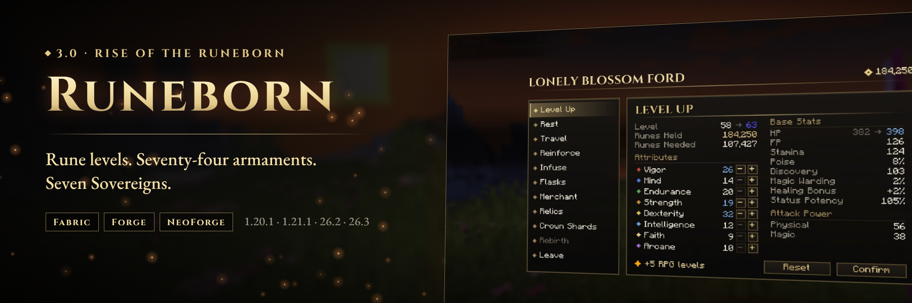
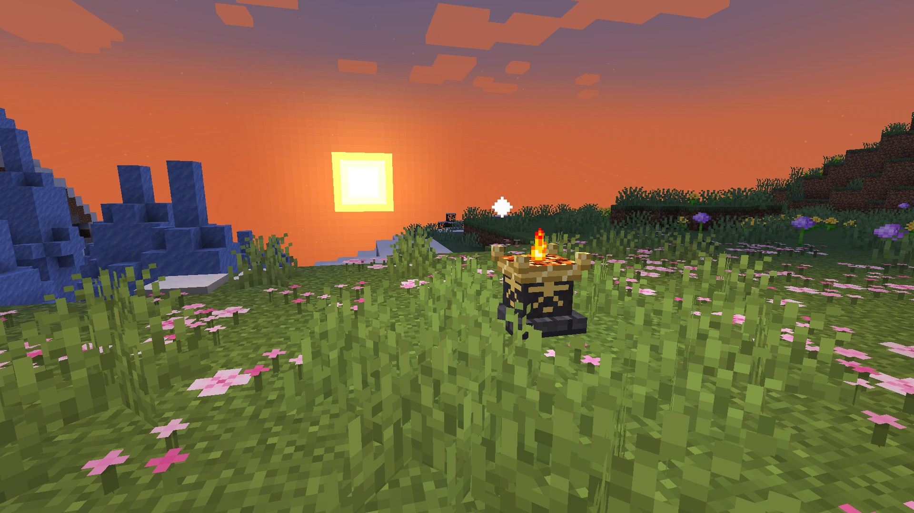
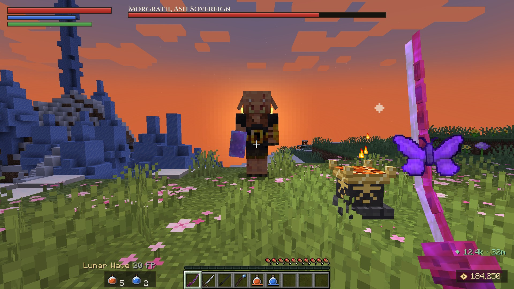
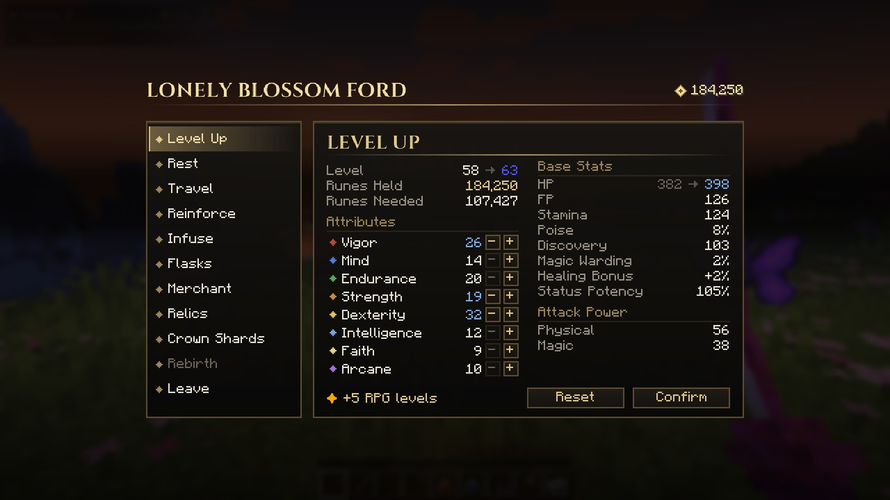
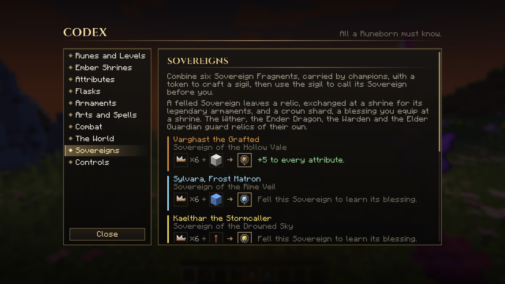

<div align="center">

# RUNEBORN

**A souls-like RPG overhaul for Minecraft.**
Rune levels, eight scaling attributes, 74 armaments with weapon arts and affinities, Ember Shrines,
champions, and Sovereign bosses that guard crown shards.

Minecraft **1.20.1** · **1.21.1** · **26.2** · **26.3** on Fabric, NeoForge and Forge

</div>



## Features

### Grow by runes, not XP
- Every kill pays out **runes**. Spend them at an **Ember Shrine** to raise one of eight attributes:
  Vigor, Mind, Endurance, Strength, Dexterity, Intelligence, Faith and Arcane.
- Your **rune level** is the sum of your attributes, and each level costs more than the last.
- **Shared progression with [RPG Attribute System](https://github.com/MeherBenSalem/RPG-Attribute-System).**
  Shrine leveling needs RPG Attribute System installed alongside Runeborn. Every rune level you buy also
  grants RPG levels, and you spend their points in its own Level Up screen. Without it, Runeborn still
  runs: your origin's attributes carry you while you reinforce, infuse and hunt.
- Die and you drop your runes where you fell. Get back to them before you die again, or they're gone.
- Start as one of **10 origins** (Knight-Errant, Warlord, Duelist, Cutthroat, Astromancer, Oracle, Ronin,
  Penitent, Hexblade or Ashborn), each with its own starting attributes and armament.

### A weapon system built on scaling
- **74 armaments across 19 classes**: daggers, straight, thrusting and curved swords, katanas,
  twinblades, greatswords, colossal swords, axes, greataxes, hammers, great hammers, spears, halberds,
  reapers, claws, whips, staves and sacred seals.
- Each weapon has physical, magic, fire, lightning and holy damage, **S–E scaling grades**, attribute
  requirements, and bleed, frost, poison or blight buildup. Swing a weapon you can't wield properly and
  you'll feel it.
- **23 weapon arts** on <kbd>R</kbd>, paid for with FP: Unsheathe, Crimson Flurry, Stormcall, Lunar
  Wave, Shadowstep, Voidstar Fall and more.
- **12 spells**: sorceries cast through staves and incantations through seals. Both scale with your
  catalyst.
- **Reinforcement**: standard weapons go to +25 with tempering stones, legendary ones to +10 with
  lustrous stones.
- **13 affinities** (Heavy, Keen, Quality, Magic, Fire, Flame Art, Lightning, Sacred, Cold, Blood,
  Poison, Occult and more) reshape a weapon's damage and scaling with crafted whetstones.
- Vanilla and modded swords, axes and tridents get implicit scaling too.

### Ember Shrines
Craft and kindle a shrine anywhere. Each shrine gets a name drawn from its biome. Resting refills your
flasks and binds you there. From a shrine you can **Level Up**, **Reinforce**, **Infuse**, upgrade your
**Flasks**, **Travel** to any kindled shrine, trade at the **Merchant**, exchange **Relics**, equip
**Crown Shards** and seek **Rebirth**.

### A dangerous world
- Mobs gain **levels** with distance from spawn and by dimension. The Nether and the End are far
  deadlier, and higher levels pay more runes.
- **Champions** spawn with affixes like Bloodthirsty, Frenzied, Blazing, Warded or Phasing.
- **Seven Sovereigns** can be summoned with sigils: Varghast the Grafted, Sylvara the Frost Matron,
  Kaelthar the Stormcaller, Ysolde the Crimson Bloom, Morgrath the Ash Sovereign, Vaelorn the
  Wyrm-Ravager, and the Dusk Rider, who also rides at night. Each has its own abilities, phases and a
  boss bar.
- Felling a Sovereign drops **relics**, which you trade for its legendary armaments, and its
  **crown shard**, a passive blessing you can equip. The Wither, Ender Dragon, Warden and Elder Guardian
  join the hunt with relics of their own.

### Clean UI
- A HUD with HP, FP and stamina bars, a rune counter, flask charges, your equipped weapon and art, the
  current target's level and status buildup, and Sovereign boss bars.
- Full-screen banners for the moments that matter: shrine kindled, Sovereign felled, YOU DIED.
- Weapon tooltips show attack power, scaling grades, requirements and the weapon art at a glance.
- Dodge roll with brief invulnerability on <kbd>Left Alt</kbd>, status screen on <kbd>I</kbd>.
- **The Codex**, reached from the status screen, explains every system and shows the crafting recipes
  for shrines, flasks, stones, whetstones and Sovereign sigils.

<table>
<tr>
<td></td>
<td></td>
</tr>
<tr>
<td></td>
<td></td>
</tr>
</table>

## Getting started

1. Join a world and pick your origin.
2. Craft an **Ember Shrine** (a campfire with gold ingots, blaze powder and polished deepslate), place it and
   use it to kindle it.
3. Kill things, collect runes and level up at the shrine (with RPG Attribute System installed). Your
   **Ember Flask** heals and your **Azure Flask** restores FP. Both refill when you rest.
4. Find or craft tempering stones and whetstones, reinforce your weapon, and go find a Sovereign.

## Downloads

| Minecraft | Loaders |
|-----------|---------|
| 26.3 | NeoForge, Fabric |
| 26.2 | NeoForge, Fabric |
| 1.21.1 | NeoForge, Fabric |
| 1.20.1 | Forge, Fabric |

The Fabric builds need [Fabric API](https://modrinth.com/mod/fabric-api). Install
[RPG Attribute System](https://github.com/MeherBenSalem/RPG-Attribute-System) for shrine leveling
([CurseForge](https://www.curseforge.com/minecraft/mc-mods/remnants-rpg-stats-skills-progression), [Modrinth](https://modrinth.com/mod/remnants-rpg-stats-skills-progression), listed as *Remnants | RPG Stats, Skills & Progression*). It is
optional, but Runeborn's level-ups stay locked without it. Releases are published to
[Modrinth](https://modrinth.com/mod/runeborn-soulslike-rpg-progression) and
[CurseForge](https://www.curseforge.com/minecraft/mc-mods/runeborn-soulslike-rpg-progression).

## Configuration

- `config/runeborn-server.json` covers rune gain, level, smithing and merchant cost multipliers, rune
  drop on death, stamina, PvP damage, mob level curves per dimension, champion chance, Dusk Rider
  spawns and shrine travel. `levelUpRequiresRpgAttributeSystem` (default `true`) and
  `rpgLevelsPerRuneLevel` (default `1`) control the RPG Attribute System link.
- `config/runeborn-client.json` covers HUD toggles, scale and offset, bar numbers, banners, the target
  bar and boss bars.

Operators can use `/runeborn runes add|set`, `/runeborn attribute <attr> <value>`,
`/runeborn origin reset`, `/runeborn summon <boss>`, `/runeborn reload` and `/runeborn info`.

## Development

```
core/       Pure Java: stats, catalog, damage math, network format, UI screens and HUD (no Minecraft)
shared/     Gameplay on Minecraft APIs that are stable across 1.20.1 to 26.3, plus all assets
versions/   One Gradle workspace per Minecraft version (common + loader projects)
  1.20.1/   Forge + Fabric, Java 17
  1.21.1/   NeoForge + Fabric, Java 21
  26.2/     NeoForge + Fabric, Java 25
  26.3/     NeoForge + Fabric, Java 25
tools/      Asset generator (sprites, models, lang, recipes) and the core test runner
```

Each version's `common/` adds `core/` and `shared/` as source roots, and supplies the per-version
`Compat` and `Platform` classes, items, mixins and client rendering.

```bash
tools/test-core.sh                                   # core unit tests (JDK 17+)
cd versions/1.21.1 && ./gradlew :fabric:build :neoforge:build
cd versions/1.20.1 && ./gradlew :forge:build :fabric:build
cd versions/26.3   && ./gradlew :fabric:build :neoforge:build   # Gradle must run on JDK 25
python3 tools/assetgen/generate.py                   # after changing the catalog (needs Pillow)
```

To run the in-game self-test on a dedicated server, set `RUNEBORN_SELFTEST=1` and run
`./gradlew :<loader>:runServer`. To get a scripted UI walkthrough with screenshots, set
`RUNEBORN_UITEST=1` and run `./gradlew :<loader>:runClient` with a world named `uitest`.

## Contributing

See [CONTRIBUTING.md](CONTRIBUTING.md). By contributing, you agree your work is licensed under
[Apache-2.0](LICENSE).

## Credits and license

Runeborn by NAIZO (Nightbeam). Licensed under the [Apache License, Version 2.0](LICENSE).
The title font is [Cinzel](https://github.com/NDISCOVER/Cinzel) by Natanael Gama, under the
[SIL Open Font License 1.1](tools/assetgen/fonts/OFL-Cinzel.txt). See [NOTICE](NOTICE).

Runeborn is a fan work inspired by the souls-like genre. It is not affiliated with or endorsed by
Mojang Studios, Microsoft, FromSoftware or Bandai Namco.
